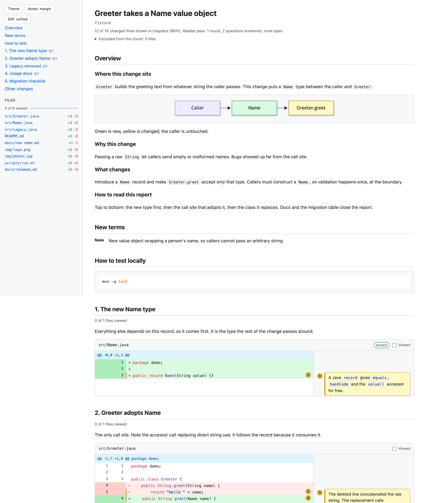
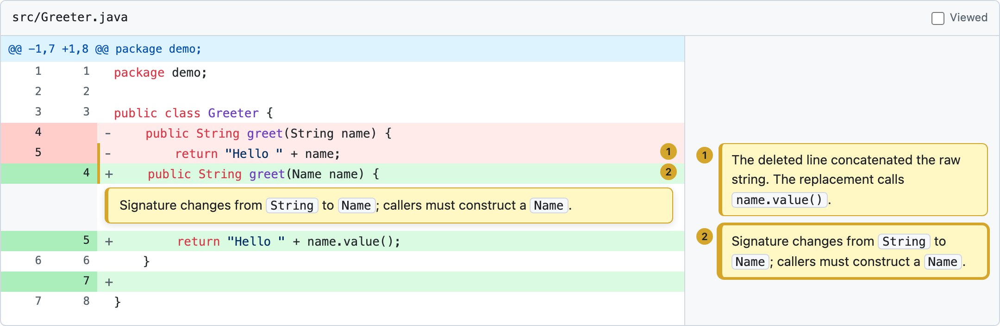

# review-report

**Read a code change as a story, not as a list of files.**

review-report is a [Claude Code](https://claude.com/claude-code) skill. Point it at a branch, a pull request or a
commit range. Claude studies the change and hands you a guided walkthrough: one HTML page with an overview,
diagrams, and the diff in chapters, with plain-English notes on the lines that need them.



## Why

A pull request lists files alphabetically. The change itself has an order: something triggers it, and each step
calls the next. Reviewers rebuild that order in their heads, one file at a time. The reasoning behind the code is
usually not in the diff at all.

This gets harder as AI agents write more of the code. Changes arrive larger and faster than anyone can read cold.

review-report gives that reconstruction to Claude, then checks the result:

- **It is the real diff.** The page is built from git's output; Claude only writes the explanation around it.
- **Nothing is quietly left out.** At least 80% of the changed lines must sit in a chapter. The rest is listed
  under "Other changes", and generated files are named with the reason they were skipped.
- **The explanation is tested before you see it.** A second agent, fresh, reads the report with only the
  pre-change code and lists every place it had to guess. Claude closes those gaps with notes.

## Quick start

Install it as a plugin:

```
/plugin marketplace add Hiveteq/review-report
/plugin install review-report@hiveteq
```

Then, inside the repository you want to review:

```
/review-report:review-report
```

Claude writes the walkthrough to `reports/review/` in that repository and gives you its path. You need Node 22 or newer
and `git`.

## What you get

- **The overview first.** Where the change sits in the existing design, why it was made, and how it works.
  Diagrams show the flow you know, with new and changed parts highlighted, or a before-and-after pair when the
  flow changes shape.
- **Chapters in the order the code runs.** The entry point comes first, then what it calls. Storage, types and
  configuration appear with the first step that needs them. Tests sit beside the code they prove, each with a
  line on what it covers and what it does not.
- **Notes beside the code.** Numbered, level with their line. Hover a line to open its note right below it, or
  switch to GitHub-style inline notes.

  
- **Diffs that feel like GitHub's.** Syntax highlighting, light and dark themes, unified or split view. Switching
  keeps your place.
- **Viewed ticks.** Tick a file and it folds; chapters and a progress bar show what is left. Ticks survive a
  re-render, except for files whose diff changed since you ticked them.
- **One file to keep or share.** Large changes become a small folder of pages, one per chapter.

## Targets

```
/review-report:review-report            # current branch against main or master
/review-report:review-report #123       # a pull request (needs the gh CLI)
/review-report:review-report v1..v2     # any git range
/review-report:review-report abc123     # one commit
/review-report:review-report --staged   # staged changes; --working for the working tree
```

## Install as a skill folder instead

Without the plugin system, link or copy the skill into your skills folder:

```bash
git clone https://github.com/Hiveteq/review-report.git
ln -s "$(pwd)/review-report/skills/review-report" ~/.claude/skills/review-report
```

The command is then `/review-report`.

## Privacy

The skill adds no service of its own. Claude reads your code the way it does in any Claude Code session, and the
walkthrough is a local file that is never uploaded. The `reports/` folder is added to `.gitignore` on first use.

When you open a walkthrough, the page loads highlight.js and Mermaid from public CDNs. Both are pinned to exact
versions with integrity hashes, and your code stays in the page. Offline, the page still works and shows plain
text.

## How it works

1. A small Node script prints the diff with old and new line numbers on every line.
2. Claude writes a **story**: an overview, chapters, and notes tied to line numbers. The format is documented
   in [`story-schema.md`](skills/review-report/reference/story-schema.md).
3. The script checks the story, takes the referenced lines from the real diff and writes the page. Every
   error names the field to fix.
4. A fresh agent reads the page and lists its guesses. Claude answers them, then looks at the page itself
   before reporting back.

The script has no dependencies beyond Node.

## Contributing

Bug reports and pull requests are welcome. Start with [`CONTRIBUTING.md`](CONTRIBUTING.md); coding agents
should read [`AGENTS.md`](AGENTS.md).

## License

MIT, © 2026 Hiveteq.
